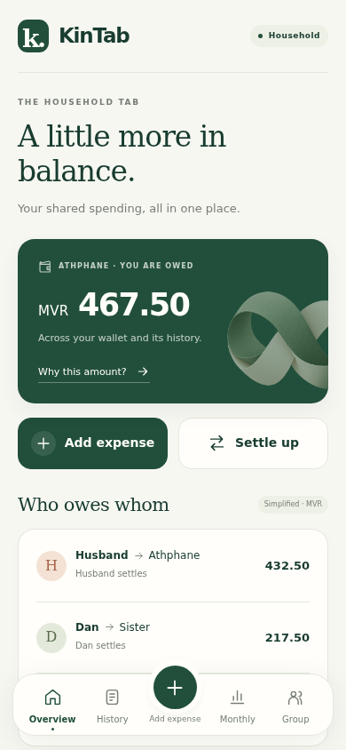
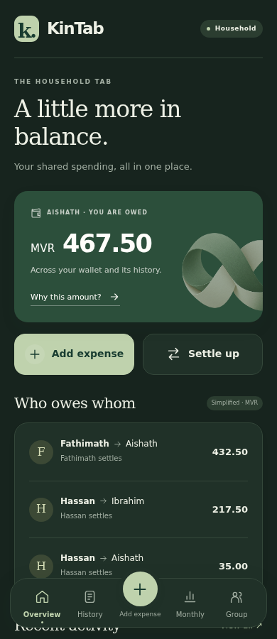
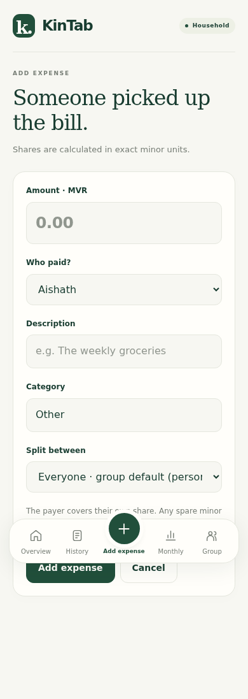
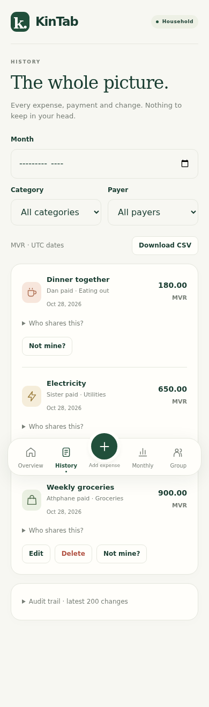
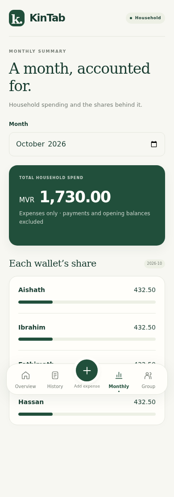
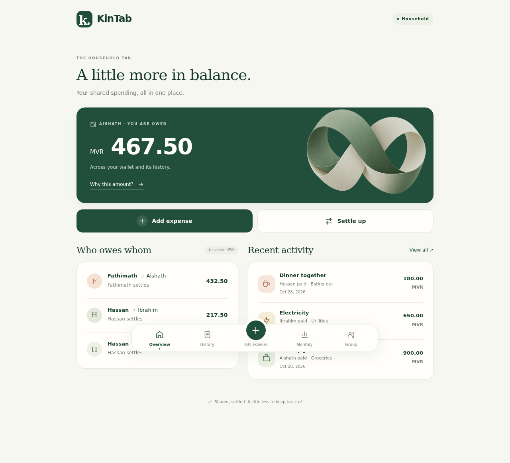
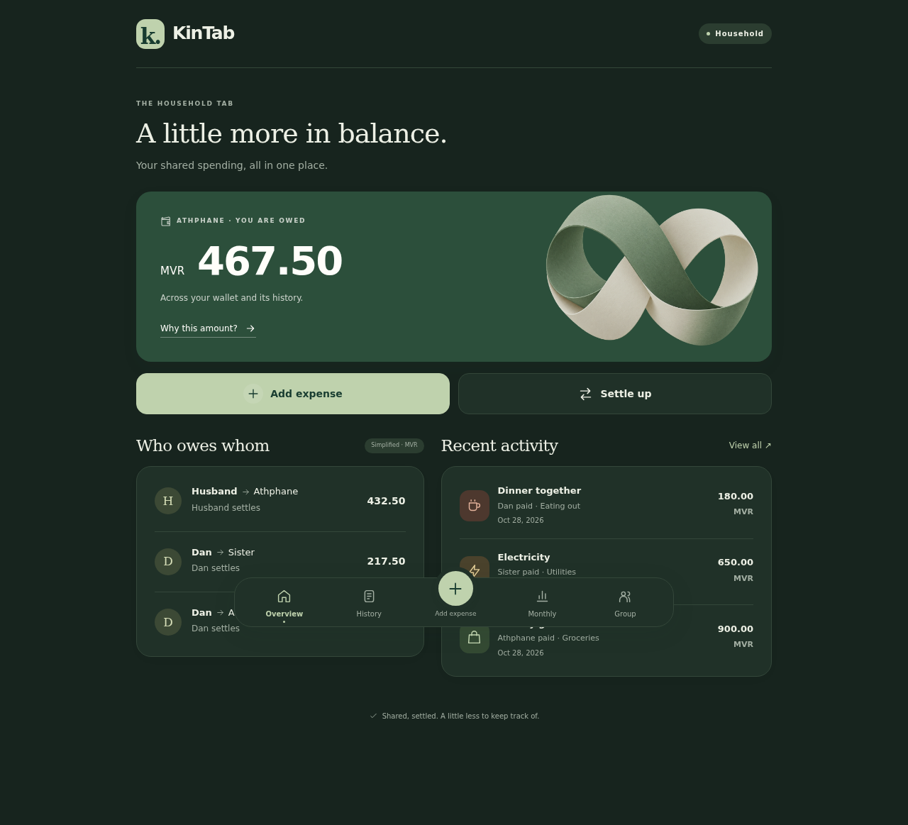
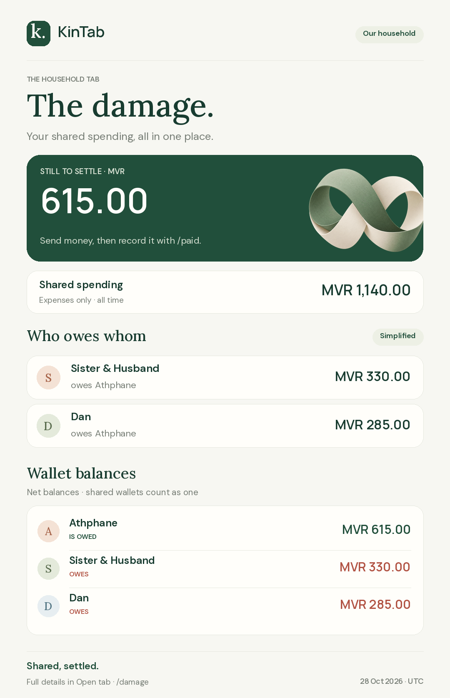
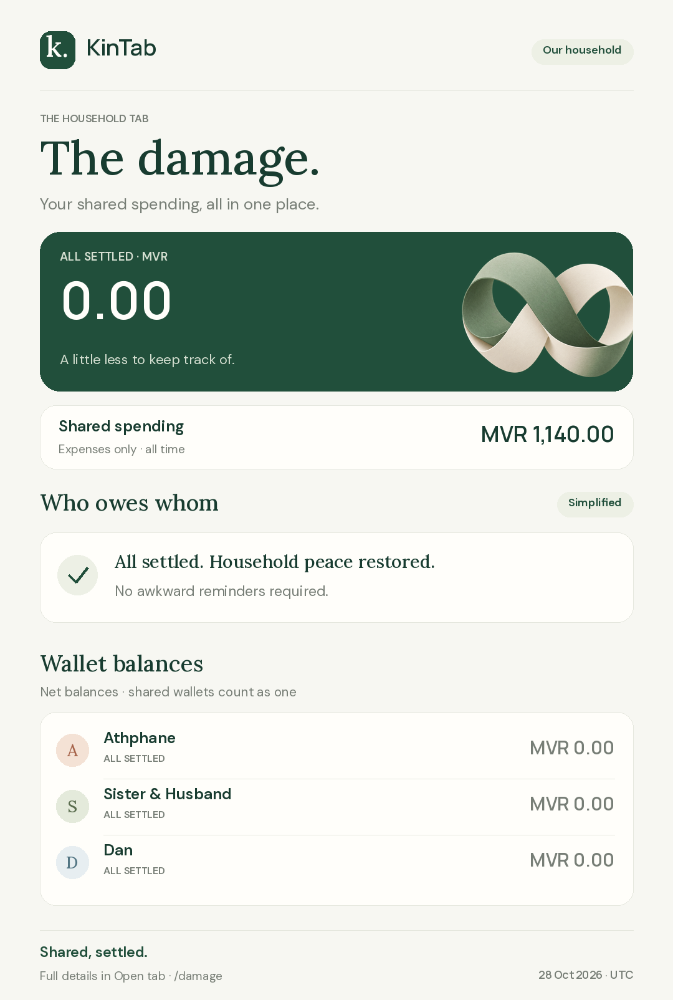

# KinTab

A Telegram bot and Mini App for household spending. People share expenses; wallets settle between them. A couple can share a wallet, and the ledger only tracks money between wallets.

The bot is **[@kintabbot](https://t.me/kintabbot)**. The web service is **https://kintab.athfan.dev**. A new household starts at **zero**, as requested. No opening debt is assumed or imported.

Long chat summaries show as many complete rows as fit Telegram's message limit, with the full details available in **Open tab**. When pinning is unavailable, expense/payment posts retain the updated running total after deletion or undo as well.

## Screenshots

The Mini App on mobile and desktop, in light and dark themes. Screenshots use a test household with sample expenses.

| Mobile overview | Dark mode |
| --- | --- |
|  |  |

| Add an expense | History | Monthly summary |
| --- | --- | --- |
|  |  |  |

[See the full mobile overview](docs/screenshots/kintab-mobile-full.png).



<details>
<summary>Desktop dark mode</summary>



</details>

The `/damage` command creates a shareable balance report with the same design, including the settlement plan and each wallet's balance.



<details>
<summary>Fully settled report</summary>



</details>

## First household setup

1. In **BotFather**, enable groups and keep **Group Privacy enabled**. Use `/newapp` to register the Mini App short name `app`, with URL `https://kintab.athfan.dev/`. If it already exists, check its URL with `/myapps`.
2. Add the bot to the household group. It posts a welcome; `/start` also shows it.
3. Tap **I'm in** to join. In **Open tab → Group → Add a member**, add other people by name and choose a new or existing wallet for each. They can share new expenses without using Telegram. Other Telegram users can also tap **I'm in** to join with their own wallet.
4. Any joined member can use **Open tab → Group → Manage shared wallets** to combine wallets directly, including guests. Both wallets must be settled; the destination wallet keeps its settler. Use **Assign a wallet** to move one person to an existing wallet or give them a new wallet. Members can also choose settlers. For an invitation instead, tap **Set up wallets**, choose a person, and have that person accept.
5. Tap **Done → Start fresh**. This starts at zero and keeps any entries already recorded. **Add opening balance** is available for other households with existing debt.
6. Give the bot permission to pin messages. Without it, the bot asks once and includes the running total under each new entry. `/tab` retries pinning.
7. Tap **Open tab** under the welcome, running total, or any expense/payment post to use the Mini App. Send `/tab` (or `/tab@kintabbot`) for a fresh reply with the button. A group button uses a Direct Link URL, not a private-chat `web_app` button. The random group token is not a chat ID.

The server verifies Telegram's signed `initData` (maximum age one hour), verifies current Telegram group membership, and checks active tab membership on every API route. Reopen the Mini App after its session expires. Any active tab member in the Telegram group can administer the tab.

## Commands

| Command | Action |
| --- | --- |
| `/spent 450 groceries` | You paid, using the group's default split |
| `/spent 1200 electricity @sister` | Log another member as payer; the post mentions them |
| Reply to a person's message with `/spent 1200 electricity` | Select a payer without a username |
| `/paid 3000` | Your wallet paid; choose a recipient if ambiguous |
| `/paid 3000 @sister` | Your wallet paid Sister's wallet |
| `/damage` or `/owed` | A fun balance image: total to settle, who pays whom, and wallet balances |
| `/tab` | Refresh and re-pin the running total |
| `/leave` | Stop sharing future expenses; past debts remain |
| `/export` | All entries, deleted/undone status, shares and audit records as CSV in DM |
| `/forget` | Any joined member: confirm permanent deletion of the whole tab |
| `/help` | Usage |

Start a private chat with the bot once before using `/export`, so Telegram permits DMs. Amounts accept `450`, `1,200` and `1200.50`; negative, zero, malformed and over-precision values are rejected. A single entry is limited to one trillion minor units.

`/damage` renders a PNG from the current ledger, using the group’s currency and debt mode. Shared spending excludes deleted expenses and all transfers; the amount to settle reflects opening balances, payments, and write-offs. The card shows up to six payments and six wallets, with full totals and a link to the remaining details in **Open tab**. It does not change balances or pins.

Expenses have separate **payer** and **logger** fields. The payer's wallet and the logger can edit or delete an expense. A participant can tap **Not mine?** to request review without changing the ledger. Either wallet can undo a payment for 24 hours in chat, and at any time in the Mini App. Both wallets can edit or undo opening balances. Only the creditor's wallet can forgive a debt. Unauthorized taps show an alert and change nothing.

## Mini App

- **Overview:** your wallet's net, simplified settlements, recent entries, add expense and settle up.
- **History:** filter by UTC month, category or payer, inspect shares, edit/delete/review permitted entries, undo transfers, download CSV and inspect the latest 200 audit records.
- **Add/edit expense:** choose payer and category; use the default split, selected people, equal selected wallets or custom person weights. Editing without changing the split retains its original people, weights and wallet snapshots.
- **Why this amount?:** every contributing expense and transfer, with paid amount, share and net contribution, for any wallet.
- **Monthly:** household spending and each wallet's share. Payments, opening balances and write-offs are excluded from spending.
- **Group:** members, guests, consent invitations, unlinking, settler changes, wallet management and group settings for all joined members (currency, decimal places, split/debt modes and weights). Currency and decimal places are fixed once entries exist.
- **Settle up:** record an actual payment, opening debt, or creditor-authorized write-off. Recording a payment never sends real money.

People added by name can start with a new wallet or share an existing wallet, and can be selected as payers and participants. They cannot personally consent to a Telegram wallet invitation; any joined member can combine their wallet directly. In **Group**, any joined member can combine settled wallets, separate any active member into their own wallet, and choose the settler for any wallet. Combining moves all active members to the destination wallet and keeps its settler. Departed members and historical entries retain their wallets; obsolete invitations are cancelled. Moving an existing member between wallets requires both wallets to have zero balance. Adding a new person directly into a shared wallet and choosing a settler are allowed at any balance. A current participant can record settlement to/from a departed wallet when their own wallet is the counterparty. A departed person can rejoin their original wallet. Removing or leaving a shared wallet never redistributes its debt.

Any joined member can manage the tab: add or remove members, create and assign wallets, change group settings, and delete the tab after confirmation. Telegram admin status is not required. Signed Telegram authentication and membership in both the Telegram group and this tab are still required in the Mini App. Removing a member only removes them from the tab, not from Telegram.

## Ledger rules

- Money is stored as integer minor units, with MVR / two decimal places by default. Decimal weights use exact rational arithmetic.
- Person mode splits by member weight; wallet mode gives each selected wallet an equal share, then allocates within that wallet.
- Remainders go to the payer when included, otherwise to participants in join order. Every expense's shares sum exactly to its amount.
- Payers and shares retain the wallet captured at entry time. An amount-only edit uses the original split specification, including historical wallets and people who left.
- A wallet's net is expenses paid minus its shares, plus outgoing transfers minus incoming transfers. Positive means it is owed. The sum of all wallet balances is always zero.
- An opening balance “A owes B” is stored as a transfer **B → A**. A payment or write-off reducing that debt is **A → B**.
- Simplification greedily matches the largest debtor and creditor. Direct mode cancels opposite pairwise debts. Greedy simplification is deterministic; it is not an exhaustive optimization over all possible transfer graphs.
- Wallets may link or unlink only at zero net balance. A closed historical wallet remains in the ledger and can be controlled by its original settler's current wallet if an old entry is later changed. No history is rewritten.
- Every ledger mutation writes before/after audit data in the same SQLite transaction. An undone/deleted entry remains visible. Chat edit notes show old and new amounts.

## Local development

Python 3.12+ and [uv](https://docs.astral.sh/uv/) are required.

```sh
cp config.ini.example config.ini
# Fill in Telegram api_id, api_hash, bot_token and bot_username.
uv sync
uv run python main.py
```

Get the bot token from BotFather and API credentials from https://my.telegram.org. `KINTAB_CONFIG` can select a different config file. Paths in config are relative to the project root; absolute paths also work. Keep `config.ini` and `workdir/` private. Logs and SQLite live in `data/`.

```sh
uv run pytest -q
uv run ruff check .
uv run ruff format --check .
node --check web/static/app.js

# Browser workflow with a test Telegram authority and a temporary database:
uv run playwright install chromium
KINTAB_BROWSER_TEST=1 uv run pytest tests/test_browser.py -q
# KINTAB_CHROMIUM=/path/to/chrome can use an existing executable.
```

The tests cover rounding/conservation, transfers, permissions, lifecycle, concurrency, cross-group isolation, HMAC tampering/expiry, API routes, chat flows and the mobile browser workflow. The browser check writes `artifacts/mobile-overview.png`. Test fixtures never use production credentials or add ledger data to the live household.

## Docker and Cloudflare

```sh
mkdir -p data workdir
chmod 600 config.ini
# The host directories must be writable by the selected PUID/PGID.
docker compose up -d --build
docker compose logs --tail 50
curl -fsS https://kintab.athfan.dev/healthz
```

The service runs as `${PUID:-1000}:${PGID:-1000}`, with container name `kintab-bot`, on `0.0.0.0:8080`. It joins the existing external `cloudflare` Docker network and publishes no host ports. Point the Cloudflare tunnel's public hostname `kintab.athfan.dev` to **`http://kintab-bot:8080`**. Mounts are `config.ini` (read-only), `data/` and `workdir/`. The image's health check verifies the web server and DB. One bot instance should use each SQLite/session pair.

Dependency versions are locked in `uv.lock`; Docker installs the pinned `requirements.txt`. After changing runtime dependencies, regenerate it:

```sh
uv export --no-dev --no-hashes --format requirements.txt -o requirements.txt
```

Back up with SQLite's backup API, which includes WAL contents safely:

```sh
docker compose exec -T kintab-bot python - <<'PY'
import sqlite3
from datetime import datetime, UTC
from pathlib import Path
source = sqlite3.connect('data/kintab.sqlite3')
destination = sqlite3.connect(Path('data') / f'backup-{datetime.now(UTC):%Y%m%d-%H%M%S}.sqlite3')
with destination:
    source.backup(destination)
destination.close()
source.close()
PY
```

SQLite uses WAL, foreign keys, `user_version` migrations and serialized transactions. Group-to-supergroup migration updates the chat ID while retaining the token and ledger. Pinned edits are coalesced over about two seconds. If a Telegram notification fails after a commit, the entry remains recorded; `/tab` refreshes the balance and the Web App shows the committed history.

## Project layout

`main.py` starts Kurigram and aiohttp in one loop. `bot/ledger.py` is pure arithmetic; `db.py` owns storage; `groups.py` and `entries.py` implement the authorized service; `perms.py` is shared by chat and web; `parse.py`, `render.py`, `notify.py` and `handlers.py` handle Telegram. `webapp.py` serves the authenticated API and plain HTML/CSS/JS in `web/`, with Telegram themes, haptics and content-hashed static URLs.

Recurring bills/reminders, receipts/OCR, internal wallet debts, automatic monthly posts and multiple currencies are the later items from `PLAN.md`; they are not part of this release.
